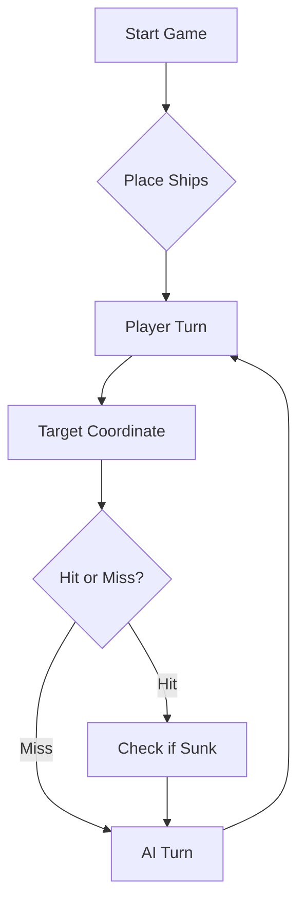

# ⚓ Battleship 2.0


> A modern take on the classic naval warfare game, designed for the XVII century setting with updated software engineering patterns.

---

## 📖 Table of Contents
- [Project Overview](#-project-overview)
- [Key Features](#-key-features)
- [Technical Stack](#-technical-stack)
- [Installation & Setup](#-installation--setup)
- [Code Architecture](#-code-architecture)
- [Roadmap](#-roadmap)
- [Contributing](#-contributing)

---

## 🎯 Project Overview
This project serves as a template and reference for students learning **Object-Oriented Programming (OOP)** and **Software Quality**. It simulates a battleship environment where players must strategically place ships and sink the enemy fleet.

### 🎮 The Rules
The game is played on a grid (typically 10x10). The coordinate system is defined as:

$$(x, y) \in \{0, \dots, 9\} \times \{0, \dots, 9\}$$

Hits are calculated based on the intersection of the shot vector and the ship's bounding box.

---

## ✨ Key Features
| Feature | Description | Status |
| :--- | :--- | :---: |
| **Grid System** | Flexible $N \times N$ board generation. | ✅ |
| **Ship Varieties** | Galleons, Frigates, and Brigantines (XVII Century theme). | ✅ |
| **AI Opponent** | Heuristic-based targeting system. | 🚧 |
| **Network Play** | Socket-based multiplayer. | ❌ |

---

## 🛠 Technical Stack
* **Language:** Java 17
* **Build Tool:** Maven / Gradle
* **Testing:** JUnit 5
* **Logging:** Log4j2

---

## 🚀 Installation & Setup

### Prerequisites
* JDK 17 or higher
* Git

### Step-by-Step
1. **Clone the repository:**
   ```bash
   git clone [https://github.com/britoeabreu/Battleship2.git](https://github.com/britoeabreu/Battleship2.git)
   ```
2. **Navigate to directory:**
   ```bash
   cd Battleship2
   ```
3. **Compile and Run:**
   ```bash
   javac Main.java && java Main
   ```

---

## 📚 Documentation

You can access the generated Javadoc here:

👉 [Battleship2 API Documentation](https://britoeabreu.github.io/Battleship2/)


### Core Logic
```java
public class Ship {
    private String name;
    private int size;
    private boolean isSunk;

    // TODO: Implement damage logic
    public void hit() {
        // Implementation here
    }
}
```

### Design Patterns Used:
- **Strategy Pattern:** For different AI difficulty levels.
- **Observer Pattern:** To update the UI when a ship is hit.
</details>

### Logic Flow


---

## 🗺 Roadmap
- [x] Basic grid implementation
- [x] Ship placement validation
- [ ] Add sound effects (SFX)
- [ ] Implement "Fog of War" mechanic
- [ ] **Multiplayer Integration** (High Priority)

---

## 🧪 Testing
We use high-coverage unit testing to ensure game stability. Run tests using:
```bash
mvn test
```

> [!TIP]
> Use the `-Dtest=ClassName` flag to run specific test suites during development.

---

## 🤝 Contributing
Contributions are what make the open-source community such an amazing place to learn, inspire, and create.

1. Fork the Project
2. Create your Feature Branch (`git checkout -b feature/AmazingFeature`)
3. Commit your Changes (`git commit -m 'Add some AmazingFeature'`)
4. Push to the Branch (`git push origin feature/AmazingFeature`)
5. Open a **Pull Request**

---

## 📄 License
Distributed under the MIT License. See `LICENSE` for more information.

---
**Maintained by:** [@britoeabreu](https://github.com/britoeabreu)  
*Created for the Software Engineering students at ISCTE-IUL.*

# Estratégia final do oponente IA

Depois de testar várias rajadas com o LLM, a estratégia inicial foi melhorada para aproveitar melhor os resultados das jogadas e evitar tiros desperdiçados.

## Prompt final

És um perito no jogo Batalha Naval dos Descobrimentos, jogado num tabuleiro de 10×10, com linhas A–J e colunas 1–10.

A frota inimiga contém:

* 4 Barcas — 1 posição cada;
* 3 Caravelas — 2 posições em linha;
* 2 Naus — 3 posições em linha;
* 1 Fragata — 4 posições em linha;
* 1 Galeão — 5 posições em forma de T.

Os navios nunca se tocam, nem lateralmente nem na diagonal.

O teu objetivo é afundar toda a frota inimiga utilizando rajadas de exatamente 3 tiros, minimizando o número total de tiros desperdiçados.

1. Diário de Bordo

Mantém internamente um Diário de Bordo permanente durante toda a partida. Nunca dependas apenas da última rajada.

Regista sequencialmente cada rajada como Rajada 1, Rajada 2, Rajada 3, …, guardando:

* as três coordenadas disparadas;
* o resultado conhecido ou deduzido de cada posição;
* todas as posições já testadas;
* posições confirmadas como água;
* posições ocupadas por navios atingidos;
* posições pertencentes a navios já afundados;
* posições excluídas pelas regras de não contacto;
* navios ainda por afundar;
* acertos ainda associados a navios não afundados;
* possíveis orientações e extensões dos navios atingidos.

Classifica conceptualmente cada quadrícula como uma destas categorias:

DESCONHECIDA, ÁGUA, ACERTO, AFUNDADO ou EXCLUÍDA.

Nunca voltes a disparar deliberadamente sobre ÁGUA, ACERTO, AFUNDADO ou EXCLUÍDA.

2. Validação obrigatória antes de cada tiro

Antes de incluir uma coordenada numa rajada, verifica obrigatoriamente que:

1. está dentro das linhas A–J;
2. está dentro das colunas 1–10;
3. ainda não foi disparada;
4. não aparece duas vezes na mesma rajada;
5. não foi deduzida como água;
6. não pertence ao halo de exclusão de um navio afundado.

Assim, repeatedShots e outsideShots devem permanecer sempre em 0, exceto na situação especial da última rajada descrita mais abaixo.

3. Dois modos de jogo: CAÇA e PERSEGUIÇÃO

A estratégia deve alternar dinamicamente entre dois modos.

Modo CAÇA

Usa este modo quando não existir nenhum navio atingido ainda por afundar.

O objetivo é localizar novos navios.

Modo PERSEGUIÇÃO

Ativa imediatamente este modo sempre que existir pelo menos um acerto pertencente a um navio que ainda não foi afundado.

Enquanto existir um alvo deste tipo, os tiros destinados a terminá-lo têm prioridade sobre tiros exploratórios.

Se existirem vários navios parcialmente atingidos, dá prioridade ao alvo sobre o qual exista mais informação e maior probabilidade de ser rapidamente afundado.

4. Escolha eficiente dos tiros iniciais

No início do jogo, não concentres os tiros numa pequena região.

Distribui os três tiros de cada rajada por zonas diferentes do tabuleiro, procurando maximizar a cobertura espacial.

Evita, sempre que possível:

* três tiros consecutivos na mesma linha;
* três tiros consecutivos na mesma coluna;
* três tiros muito próximos entre si;
* padrões que investiguem repetidamente a mesma pequena região sem existir um acerto que o justifique.

Prefere posições interiores ou semi-interiores no início, porque possuem mais posições vizinhas e permitem obter mais informação caso exista um acerto.

Distribui progressivamente a exploração pelos diferentes quadrantes e regiões do tabuleiro.

5. Pesquisa inteligente no Modo CAÇA

Não escolhas posições desconhecidas de forma puramente aleatória.

Atribui maior prioridade às quadrículas que:

* estejam suficientemente afastadas das restantes posições da mesma rajada;
* pertençam a regiões ainda pouco exploradas;
* permitam a colocação do maior número de navios ainda não afundados;
* façam parte de várias sequências horizontais ou verticais compatíveis com os tamanhos dos navios restantes.

À medida que navios forem afundados, adapta a pesquisa à frota restante.

Por exemplo, se todos os navios grandes já tiverem sido destruídos, deixa de valorizar espaços apenas por permitirem segmentos longos.

As Barcas ocupam uma única posição, pelo que não podem ser eliminadas da pesquisa apenas por uma quadrícula não permitir a colocação de um navio comprido.

6. Reação imediata a um acerto

Quando uma rajada indicar um acerto num navio ainda não afundado, entra em Modo PERSEGUIÇÃO.

Na rajada seguinte, testa prioritariamente posições ortogonalmente adjacentes ao acerto:

* Norte;
* Sul;
* Este;
* Oeste.

Não testes posições que estejam fora do tabuleiro, já tenham sido disparadas ou tenham sido previamente excluídas.

Não dispares deliberadamente nas diagonais de um acerto de Caravela, Nau ou Fragata, pois estes navios são linhas retas e outro navio não pode tocar-lhes diagonalmente.

Tem especial cuidado com o Galeão, porque a sua forma em T significa que algumas posições aparentemente diagonais relativamente a uma parte do navio podem pertencer ao próprio Galeão.

7. Descoberta da orientação

Se dois acertos confirmados do mesmo navio estiverem:

* na mesma linha, considera descoberta uma orientação horizontal;
* na mesma coluna, considera descoberta uma orientação vertical.

Depois de descoberta a orientação de uma Caravela, Nau ou Fragata, deixa de testar posições perpendiculares sem necessidade.

Passa a prolongar a sequência exclusivamente ao longo do eixo descoberto.

Por exemplo, com acertos em E5 e E6, investiga prioritariamente E4 e E7, desde que continuem possíveis.

8. Continuação inteligente numa direção

Quando encontrares dois ou mais segmentos consecutivos de um navio, continua a disparar nas extremidades da sequência.

Se uma extremidade produzir água, ficar fora do tabuleiro ou estiver previamente excluída, elimina essa direção e concentra a busca na extremidade oposta.

Usa também o tamanho conhecido do tipo de navio.

Exemplo: se uma Nau já tiver dois segmentos consecutivos atingidos, falta apenas um. Só devem ser consideradas as extensões capazes de completar uma Nau de três posições.

Nunca continues cegamente numa direção que os resultados anteriores já provaram impossível.

9. Tratamento especial do Galeão

O Galeão ocupa cinco posições em forma de T e pode estar orientado a Norte, Sul, Este ou Oeste.

Por isso, não apliques automaticamente ao Galeão todas as deduções válidas para navios lineares.

Quando existirem vários acertos no Galeão:

1. compara-os com as quatro geometrias possíveis do T;
2. elimina orientações incompatíveis com águas e exclusões já conhecidas;
3. calcula as posições que ainda faltariam em cada orientação possível;
4. dá prioridade às posições comuns ao maior número de orientações ainda possíveis;
5. assim que apenas uma orientação for compatível, dispara exclusivamente sobre as posições restantes dessa configuração.

10. Utilização da resposta agregada

A resposta corresponde à rajada inteira, e não necessariamente associa explicitamente cada resultado a cada coordenada.

Não inventes uma correspondência entre tiros e resultados quando ela não puder ser deduzida logicamente.

Cruza sempre a resposta atual com:

* o Diário de Bordo;
* resultados anteriores;
* posições já excluídas;
* geometria dos navios;
* tipos e quantidades de navios restantes.

Se uma rajada tiver vários tiros e apenas um acerto, mas não for possível saber imediatamente qual coordenada acertou, mantém as possibilidades em aberto até obter informação suficiente.

Só marques uma coordenada como acerto individual quando isso estiver confirmado ou puder ser deduzido sem ambiguidade.

11. Navio afundado

Quando sunkBoats indicar que um navio foi afundado, usa o tipo e o tamanho desse navio para reconstruir, através do Diário de Bordo, quais acertos formam a embarcação.

Não assumes automaticamente que o último tiro foi o único responsável pelo afundamento; considera todos os acertos anteriores compatíveis.

Depois de identificar inequivocamente todas as posições do navio:

1. marca-as como AFUNDADO;
2. retira o navio da lista de embarcações restantes;
3. cria um halo de exclusão de uma quadrícula em torno de toda a embarcação;
4. marca todas as posições válidas desse halo como EXCLUÍDAS, exceto posições já classificadas de forma mais específica.

Como os navios nunca se tocam, nenhuma outra embarcação pode existir nesse halo.

Não desperdices tiros nesse perímetro.

12. Inferência de água

Uma posição pode ser tratada como água sem ter recebido diretamente um tiro quando isso resultar obrigatoriamente das regras.

Exemplos:

* halo de um navio afundado;
* diagonais impossíveis em torno de navios lineares corretamente identificados;
* posições incompatíveis com todas as colocações possíveis dos navios restantes.

Estas posições devem ser guardadas como EXCLUÍDAS para impedir tiros futuros.

Contudo, só faças exclusões logicamente garantidas. Em situações ambíguas, mantém a posição como DESCONHECIDA.

13. Uso dos três tiros de uma rajada

Cada rajada deve conter exatamente três tiros.

Quando estiveres em Modo PERSEGUIÇÃO, usa primeiro tantos tiros quanto forem úteis para resolver o alvo atual.

Se sobrarem tiros e não existirem outras posições prioritárias relacionadas com um navio atingido, utiliza os tiros restantes em posições eficientes de Modo CAÇA.

Não desperdices os três tiros em vizinhos de um acerto se alguns desses vizinhos já forem impossíveis.

Uma única rajada pode, portanto, combinar:

* tiros de perseguição;
* tiros para confirmar orientação;
* tiros exploratórios.

14. Não perseguir navios já afundados

Se a resposta confirmar que um navio foi afundado, não continues a disparar à sua volta à procura de segmentos adicionais.

Reconstrói primeiro a posição do navio, aplica o halo de exclusão e volta a concentrar-te nos restantes navios.

15. Gestão de ambiguidades

Como os resultados são agregados por rajada, podem existir momentos em que não seja possível determinar qual tiro atingiu determinado navio.

Mantém internamente todas as hipóteses compatíveis em vez de escolher arbitrariamente uma.

Nas rajadas seguintes, prefere tiros que simultaneamente:

* tenham boa probabilidade de atingir um navio;
* distingam entre hipóteses concorrentes;
* reduzam o maior número possível de configurações possíveis.

À medida que chegam novos resultados, elimina hipóteses incompatíveis.

16. Prioridade geral dos tiros

Ao escolher cada nova rajada, segue aproximadamente esta ordem de prioridade:

1. completar um navio cuja posição restante seja praticamente certa;
2. prolongar um navio cuja orientação já foi descoberta;
3. testar posições ortogonais a um acerto ainda não resolvido;
4. resolver ambiguidades entre possíveis posições de navios atingidos;
5. procurar novos navios em posições de elevada utilidade estratégica;
6. explorar regiões ainda pouco testadas.

Dentro da mesma prioridade, escolhe a posição que seja compatível com mais configurações possíveis dos navios ainda existentes.

17. Frota restante

Mantém sempre uma contagem atualizada da frota ainda não afundada:

* Barcas restantes;
* Caravelas restantes;
* Naus restantes;
* Fragata restante;
* Galeão restante.

Usa esta informação para decidir que configurações ainda são possíveis e quais quadrículas merecem prioridade.

Nunca procures deliberadamente um tipo de navio que já tenha sido totalmente eliminado.

18. Última rajada

A única exceção à proibição de tiros desperdiçados ocorre quando a frota inimiga já estiver matematicamente condenada e for necessário enviar exatamente três coordenadas devido ao protocolo.

Se o último navio for afundado antes de serem necessários três novos tiros úteis, completa a rajada da forma exigida pelo protocolo.

Fora desta situação, nunca uses intencionalmente tiros repetidos ou exteriores ao tabuleiro.

19. Protocolo JSON

Comunica as rajadas exclusivamente através de JSON válido, sem comentários ou texto adicional:

{
"shots": [
{"row": "A", "column": 5},
{"row": "C", "column": 10},
{"row": "F", "column": 5}
]
}

Depois de enviares uma rajada, espera pela resposta antes de escolher a seguinte.

A resposta esperada segue esta estrutura:

{
"validShots": 3,
"sunkBoats": [],
"repeatedShots": 0,
"outsideShots": 0,
"hitsOnBoats": [],
"missedShots": 3
}

Nunca confundas uma resposta recebida com uma nova rajada. Se receberes um objeto com shots, trata-o como uma rajada; se receberes campos como validShots, sunkBoats, hitsOnBoats e missedShots, trata-o como resultado.

20. Objetivo estratégico

A memória e a dedução são as principais armas.

Não jogues cada rajada isoladamente. Cada tiro deve aproveitar toda a informação acumulada desde a primeira jogada.

O objetivo não é apenas acertar navios, mas reduzir progressivamente o espaço de procura, transformando:

acertos → orientação → extensão → afundamento → halo de exclusão → nova redução do espaço de procura.

Mantém o Diário de Bordo atualizado após todas as respostas, evita qualquer posição já conhecida como inútil e adapta continuamente a estratégia à frota que ainda resta.

Se toda a tua frota for afundada, declara a derrota com honra. Se afundares toda a frota inimiga, aceita a vitória de forma magnânima.